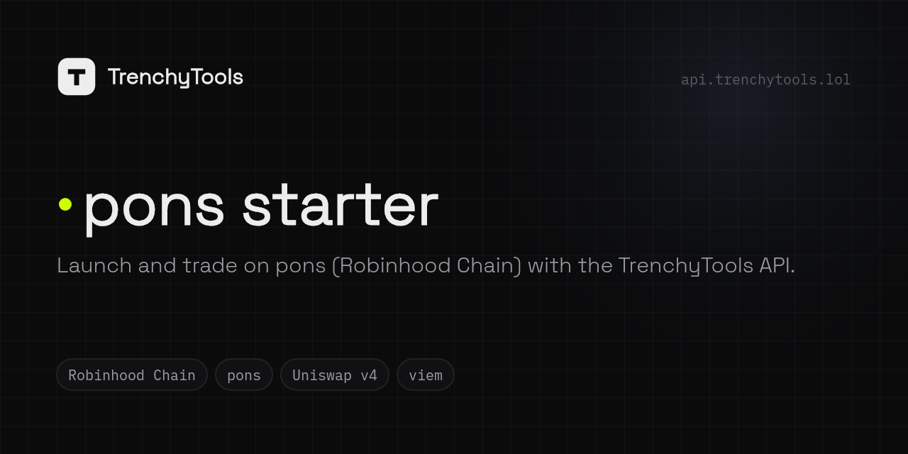

**Start here → [trenchy.tools](https://trenchy.tools)** · part of [TrenchyTools](https://github.com/Trenchy-Tools) — one API key to launch and trade on pump.fun and pons.

<!-- trenchytools:header -->
<p align="center"></p>

<p align="center"><a href="https://pons.trenchy.tools"><b>Live demo</b></a> · <a href="https://trenchy.tools/docs">Docs</a> · <a href="https://api.trenchy.tools/api/create-api-key">Get an API key</a> · <a href="https://api.trenchy.tools/AGENTS.md">AGENTS.md</a> · <a href="https://api.trenchy.tools/openapi.json">OpenAPI</a> · <a href="https://trenchy.tools/status">Status</a> · <a href="https://t.me/trenchytools">Telegram</a> · <a href="https://x.com/trenchytoolz">X</a></p>

# pons starter

The official starter for launching on **pons** (Robinhood Chain, chain id 4663, native ETH) with the
[TrenchyTools API](https://api.trenchy.tools/AGENTS.md). One Next.js app, one process, one `npm run dev`.
A sibling of the pump.fun starter: same theme, same wallet folder, EVM instead of Solana.

## What it is

- **Wallets**: one list, each wallet a file on your Desktop. **+ New wallet** (× N) or **Import ▾** a 0x key; the first
  one becomes ★, the main wallet that pays for everything and receives gathers (click ☆ to move it). Click a label to
  rename. Per row **Fund** (from ★) and **Key**; tick rows for **Amount each · Fund from ★ · Fund via exchange ▾ · Gather
  to ★ · Export keys · Archive**. Results are toasts; API errors are shown verbatim.
- **Launch**: name, symbol, image, socials, the dev wallet (★ unless changed) and **Pick buyers**: tick wallets, give each
  an ETH amount (pills, split evenly, `+ create N new`); snipers and holders under Advanced. A funding plan, a simulation,
  then the launch with a live log of every hash.
- **Trading**: every wallet in a row with **[amount] Buy** and **25 / 50 / 100 %** sell buttons that act at once; tick rows
  to buy or sell across the selection or add a timed sell; the coin's trades live on the right.

The app holds your keys and signs locally with [viem](https://viem.sh). It never talks to an RPC node or IPFS: the API
builds every transaction (`POST /api/rh/trade-local`), tells the signer what the chain knows (`GET /api/rh/account`),
broadcasts (`POST /api/rh/send`) and confirms (`GET /api/rh/tx/:hash`). No database, no login, no encryption layer:
a local, single-user tool.

## 5-minute start

```bash
cd demos/pons-starter
npm install
cp .env.example .env
curl "https://api.trenchy.tools/api/create-api-key?label=pons-starter"   # → { "apiKey": "…" }, shown once
# paste the key into .env as TRENCHY_API_KEY (or later in the app's Settings sheet)
npm run dev
```

Open http://localhost:3000. The top bar shows three pills at all times: the API key check (`GET /api/me`), the ★ wallet,
and the wallet folder. On **Wallets**, press **+ New wallet** (it becomes ★), send it a little ETH on Robinhood Chain, make
two more wallets, tick them and **Fund from ★**. Start with tiny sizes (0.001 ETH) and **Simulate** before the first launch.

## Where your keys are

Every wallet is a JSON file in one folder:

| Setting                     | Folder                                                        |
| --------------------------- | ------------------------------------------------------------- |
| `WALLET_BACKUP_DIR` set     | that folder                                                   |
| otherwise, Desktop exists   | `~/Desktop/trenchytools-wallets`                              |
| otherwise                   | `~/trenchytools-wallets`                                      |

Files are named `<date>-rh-<role>-<0xaddress>.json` and hold
`{ publicKey, privateKey, chain: "rh", role, label, createdAt, app, note }`; every wallet is also one line in
`wallets.csv` (with a `chain` column). The folder is shared with the pump.fun starter, which writes `chain: "sol"`
files; this app lists only `chain: "rh"`. Its own state (settings incl. the ★ wallet as `mainWallet`, launch records)
sits in `_app/pons-starter/`; archived wallets' files move to `archived/` (keys kept, never used). `role` in a file is only
a tag: launches take the wallets you tick, each with its own amount.

The folder **is** the store. The app lists wallets by reading it, writes a file **before** a create or import returns,
and refuses to fund, launch with, trade with or gather from any wallet whose file is missing
(HTTP 409 `not_backed_up`). "Rewrite backups" restores missing files from `wallets.csv` and adds missing CSV lines.
Back the folder up like you would a seed phrase: anyone with a file controls that wallet.

## How a launch works on pons

pons is an EVM launchpad with a bonding curve that graduates to a Uniswap v4 pool. Three things differ from Solana:

1. **Signing needs chain data.** Before signing, the app reads `GET /api/rh/account?wallet=0x…` for `chainId`,
   `pendingNonce`, `maxFeePerGas` and `maxPriorityFeePerGas`, takes the nonce once per wallet per batch and adds 1 per
   transaction. Every API answer is an ordered list of `{ label, to, data, value, gas }`; each one is signed with
   `account.signTransaction`, sent with `POST /api/rh/send { transaction }` and confirmed with `GET /api/rh/tx/:hash`.
   An `approve` is confirmed before the transaction after it goes out.
2. **No bundles, no Jito, no lookup tables.** The chain has a sequencer and no public mempool. "Bundle" here means: the
   create goes out, and the moment `GET /api/rh/tx/:hash` says `success`, every bundle wallet's buy is sent at once,
   each with its own nonce. Snipers follow staggered by `sniperGapMs`; holders are spread over `holderWindowS` with
   jitter after `holderDelayS` (Settings).
3. **Snipe tax.** pons taxes buys in the launch window unless the wallet is on the creator's exempt list. The create
   call carries `tokenMetadata` and `exemptWallets` (up to 31); the app puts every bundle, sniper and holder wallet on
   that list and warns when there are more than 31.

The launch itself: image → `POST /api/ipfs` → `metadata.image`; `POST /api/rh/trade-local { wallet: dev, action:
"create", tokenMetadata, amount, exemptWallets, slippage }` → `transactions[]` (create + fee) and `predicted.token`;
sign and send in order; wait for `success`; then the buys (`POST /api/rh/trade-local { action: "buy", token:
predicted.token, amount }` per wallet). The log shows every hash with its Blockscout link and the coin's pons page; the
record lands in `_app/pons-starter/launches.json`.

**Funding plan**: per buy, ETH + the API's 0.5 % fee + a 0.0005 ETH gas reserve; the dev wallet adds the 0.0005 ETH
pons launch fee. "Fund from funding wallet" tops up exactly the shortfall. **Simulate** runs the create transactions
through `POST /api/rh/simulate` on a copy of the chain; nothing is sent. The run refuses before anything is built when
a wallet file is missing or any wallet is short of ETH.

**There is no vanity page.** On Solana a mint keypair can be ground for a suffix because the mint address is the
keypair. On pons the token address is derived by CREATE2 from the whole create form (name, symbol, image, socials,
creator, salt): editing anything moves it, and there is no cheap grind the API exposes. The address is known before
you sign (`predicted.token`); that is as far as it goes.

## Trading and timed sells

Pick one of your launches or paste a token. Every wallet is a row with its ETH, its tokens and their value
(`GET /api/rh/balances`), then **[amount] Buy** and **25% · 50% · 100%** sell buttons that act at once; the result (or the
API's error, verbatim) is a toast. A sell sends `amount: "50%"` (the API resolves it from the real balance) and the answer
`[approve?] sell fee` goes out in order, the approve confirmed first. Tick rows for the bar: **Buy [x] each · Sell 25 / 50 /
100 % of selected · Timed sell ▾** (*in N minutes sell X %*, kept in the server's memory with a countdown; a restart
forgets them). **Live trades** on the right come from the API websocket (`wss://…/api/rh/data`, `subscribeTokenTrade`)
with explicit `connecting… / no trades yet / N trades` states; your own wallets are flagged. pons has no creator-fee
endpoint, so there is no claim row.

## The one file to copy

[`lib/trenchy.ts`](lib/trenchy.ts) is the whole API client: one documented method per endpoint, `ApiError` with
`status · code · hint · docs`, and `sendAll()` (account read → nonce run → send in order → confirm). It depends only on
viem, takes the key in its constructor and runs in Node and in the browser alike; drop it into your own project with
[`lib/core/evm.ts`](lib/core/evm.ts) (the signer) and [`lib/core/errors.ts`](lib/core/errors.ts) and you have everything this app
uses. [`lib/wallets.ts`](lib/wallets.ts) is the folder store with the backup rule.

Every error the API returns is shown exactly as returned: message, `code`, `hint`, docs link.

## Build it with AI

Paste this into your coding agent together with `https://api.trenchy.tools/AGENTS.md`:

> Build a pons (Robinhood Chain) launch tool on the TrenchyTools API. Read `https://api.trenchy.tools/AGENTS.md`
> and `openapi.json` first; use only endpoints that exist there. Keys stay local: `trade-local` returns unsigned EVM
> transactions, sign them with viem using `GET /api/rh/account` for chainId, nonce and fees, send with
> `POST /api/rh/send`, confirm with `GET /api/rh/tx/:hash`, in order; confirm an `approve` before the next one. Write
> every generated wallet to a JSON file in a folder the user can find before it holds anything, and refuse to fund a
> wallet without a file. Put every buyer on `exemptWallets` (≤ 31) of the create. Simulate with `POST /api/rh/simulate`
> before the first real send and start with ≤ 0.001 ETH. Show every API error with its `code`, `hint` and `docs`.

The code in `lib/` is the reference answer to that prompt.

## Host it

```bash
docker build -t pons-starter .
docker run -p 3000:3000 -v pons-wallets:/data -e TRENCHY_API_KEY=… pons-starter
```

The image is `node:24-slim` with Next's standalone output. `WALLET_BACKUP_DIR` is `/data/wallets`; mount a volume at
`/data` or the wallet files vanish with the container. The app has no login: put it behind something that does before
exposing it beyond localhost.

## Hosted demo mode

The public demo (`pons.trenchy.tools`) is this same app built in **demo mode**, so strangers can use it without anyone
holding their keys:

```bash
NEXT_PUBLIC_DEMO=1 npm run build              # build-time flag: the pages talk to the in-browser engine
DEMO_MODE=1 node .next/standalone/server.js   # runtime flag: every /api/* route answers 404 { code: "demo_mode" }
```

What differs from local mode (which is unchanged without the flags):

- **Keys live in the visitor's browser** (`localStorage`, one entry per wallet, same shape as a wallet file). Signing happens in
  the tab with viem: `GET /api/rh/account` (pendingNonce, fees, chainId) → `account.signTransaction` per transaction, nonce + 1
  per transaction of a run → `POST /api/rh/send` → `GET /api/rh/tx/:hash`. The server keeps no state and serves no wallet route
  ([`proxy.ts`](proxy.ts) → `demoGuard` in `lib/http.ts`).
- **Backup first:** a new wallet is *not backed up* and cannot be funded, launched with, traded or gathered (`409 not_backed_up`)
  until **Download backup** (top bar or Wallets page) has saved its key: one JSON file per click, with the CSV text inside it.
  **Export all keys** downloads everything any time. Clearing the site's data deletes the keys.
- **Each visitor gets their own API key**, created in the browser on the first visit (`GET /api/create-api-key?label=demo-pons`)
  and kept in `localStorage`. Settings shows it masked, takes a pasted key, and shows the API's refusal verbatim when creation is
  rate-limited. Every API call (and the live-trades websocket `wss://api.trenchy.tools/api/rh/data`) goes straight from the
  browser to `https://api.trenchy.tools`.
- **Launches and timed sells run in the tab**: keep it open. Timed sells are kept in `localStorage` and resume on reload.
- A strict Content-Security-Policy is sent (`next.config.ts`): scripts from this origin only, network to this origin and the API only.

How it is built: the pages call their routes through `appFetch` / `appEvents` ([`lib/browser/demo.ts`](lib/browser/demo.ts)).
In demo mode those are answered by [`lib/browser/engine.ts`](lib/browser/engine.ts), which has the same routes and shapes and
runs the same flows as the server ([`lib/core/*`](lib/core): launch executor, trading, funding, timers, the signer and its
nonce run), on the browser key store ([`lib/browser/keystore.ts`](lib/browser/keystore.ts)) with viem keys
([`lib/browser/signer-evm.ts`](lib/browser/signer-evm.ts)).

MIT licensed.
